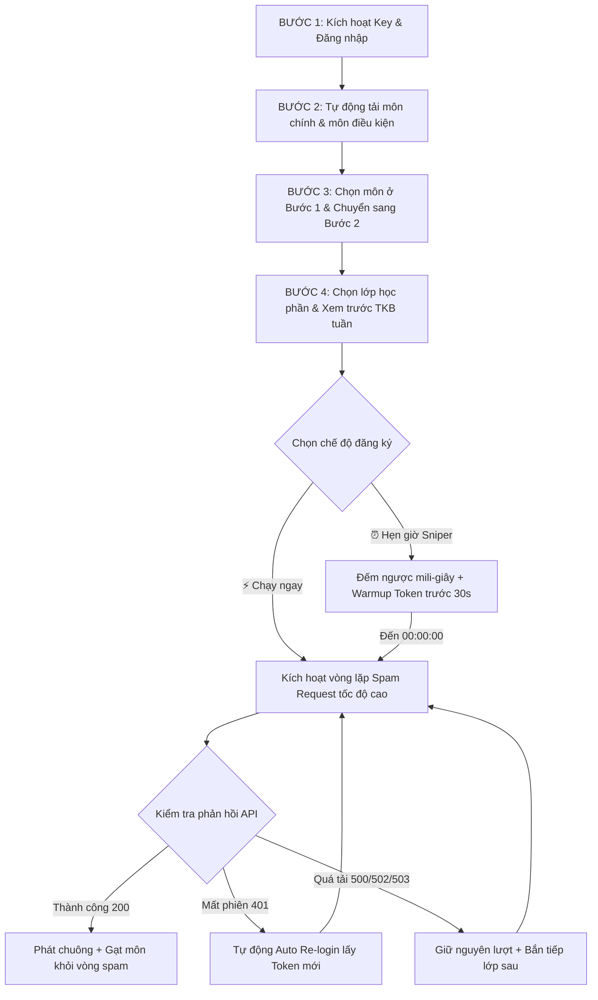
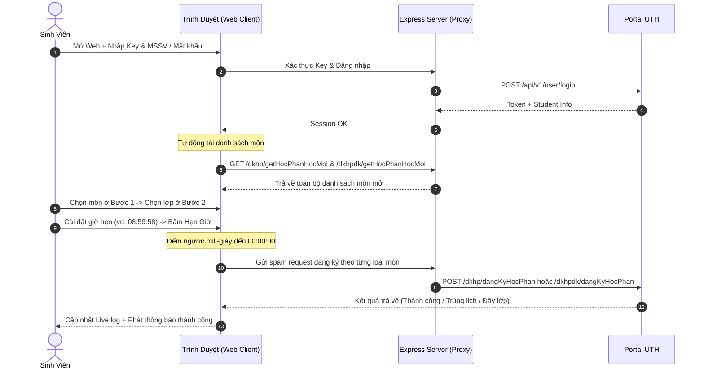

# 📘 TÀI LIỆU TOÀN DIỆN VỀ PIPELINE HOẠT ĐỘNG VÀ HỆ THỐNG TOOL ĐKHP UTH (TỪ A - Z)

---

## 📑 MỤC LỤC
1. [Giới Thiệu Tổng Quan & Triết Lý Thiết Kế](#1-giới-thiệu-tổng-quan--triết-lý-thiết-kế)
2. [Kiến Trúc Kỹ Thuật (Architecture & Tech Stack)](#2-kiến-trúc-kỹ-thuật-architecture--tech-stack)
3. [Chi Tiết Pipeline Hoạt Động Từng Bước (A - Z)](#3-chi-tiết-pipeline-hoạt-động-từng-bước-a---z)
   - [Bước 1: Hệ Thống Bản Quyền & Kích Hoạt Key](#bước-1-hệ-thống-bản-quyền--kích-hoạt-key)
   - [Bước 2: Xác Thực Đăng Nhập & Bảo Mật Không Lưu Trữ](#bước-2-xác-thực-đăng-nhập--bảo-mật-không-lưu-trữ)
   - [Bước 3: Tự Động Tải & Phân Loại Môn Học (Chính & Điều Kiện)](#bước-3-tự-động-tải--phân-loại-môn-học-chính--điều-kiện)
   - [Bước 4: Cấu Hình Lớp Học Phần & Phân Tích Trùng Lịch Tuần](#bước-4-cấu-hình-lớp-học-phần--phân-tích-trùng-lịch-tuần)
   - [Bước 5: Chế Độ Sniper Hẹn Giờ & Khởi Động Trước (Warmup Token)](#bước-5-chế-độ-sniper-hẹn-giờ--khởi-động-trước-warmup-token)
   - [Bước 6: Vòng Lặp Spam Request Tốc Độ Cao & Điều Hướng API Thông Minh](#bước-6-vòng-lặp-spam-request-tốc-độ-cao--điều-hướng-api-thông-minh)
   - [Bước 7: Cơ Chế Tự Phục Hồi (Auto Re-login) & Giữ Nguyên Lượt Khi Server Lag](#bước-7-cơ-chế-tự-phục-hồi-auto-re-login--giữ-nguyên-lượt-khi-server-lag)
   - [Bước 8: Đăng Ký Mã Lớp Học Phần Bị Ẩn (Direct ID Injection)](#bước-8-đăng-ký-mã-lớp-học-phần-bị-ẩn-direct-id-injection)
4. [Sơ Đồ Luồng Dữ Liệu Hoạt Động (Flowcharts & Sequence Diagrams)](#4-sơ-đồ-luồng-dữ-liệu-hoạt-động-flowcharts--sequence-diagrams)
5. [Bảng Tra Cứu API & Endpoints Chi Tiết](#5-bảng-tra-cứu-api--endpoints-chi-tiết)
6. [Bộ Prompt Tạo Ảnh Sơ Đồ Pipeline A-Z Chuẩn AI](#6-bộ-prompt-tạo-ảnh-sơ-đồ-pipeline-a-z-chuẩn-ai)
7. [Hướng Dẫn Triển Khai & Vận Hành (Local, Multi-Port, Docker, Cloudflare)](#7-hướng-dẫn-triển-khai--vận-hành-local-multi-port-docker-cloudflare)
8. [Xử Lý Sự Cố & Câu Hỏi Thường Gặp (FAQ)](#8-xử-lý-sự-cố--câu-hỏi-thường-gặp-faq)

---

## 1. Giới Thiệu Tổng Quan & Triết Lý Thiết Kế

**Tool ĐKHP UTH** là giải pháp phần mềm hỗ trợ sinh viên Trường Đại học Giao thông vận tải TP.HCM (UTH) đăng ký học phần tự động với tốc độ cao, khả năng hẹn giờ bắn request chính xác đến từng mili-giây và khả năng tự phục hồi khi hệ thống nhà trường quá tải.

### Triết lý cốt lõi:
1. **Zero Server Storage (Bảo mật tối đa):** Máy chủ **tuyệt đối không lưu trữ** MSSV, mật khẩu hay token của sinh viên vào bất kỳ cơ sở dữ liệu nào. Mọi thông tin chỉ tồn tại trong `localStorage` cục bộ của trình duyệt người dùng.
2. **Smart API Dispatching (Nhận diện tự động):** Tự động phân luồng môn chính và môn điều kiện (GDTC, Tiếng Anh...) để gửi đúng endpoint Portal.
3. **Fault-Tolerant Loop (Kiên cường trước sự cố):** Phân biệt chính xác giữa lỗi mất phiên (HTTP 401) và nghẽn mạng/server quá tải (500, 502, 503, 504) để xử lý thích ứng mà không gián đoạn lượt đăng ký.

---

## 2. Kiến Trúc Kỹ Thuật (Architecture & Tech Stack)

```
┌─────────────────────────────────────────────────────────────┐
│                   BROWSER CLIENT (Vanilla JS)                │
│  - Unified 2-Step Wizard (Main & Extra Courses)            │
│  - Millisecond Sniper Engine & Token Warmup Worker         │
│  - Timetable Conflict Analyzer & Schedule Grid             │
│  - LocalStorage Protected Credentials                      │
└──────────────────────────────┬──────────────────────────────┘
                               │ Base64 Obfuscated REST API
                               ▼
┌─────────────────────────────────────────────────────────────┐
│                 NODE.JS EXPRESS BACKEND GATEWAY             │
│  - Multi-Port Clustering (Port 3000 -> 3009)                │
│  - /gateway (Encrypted Payload Proxy & Disguise)           │
│  - /api/keys (License Manager & HWID Device Binding)        │
│  - /api/auth (Login & Session Dispatcher)                   │
└──────────────────────────────┬──────────────────────────────┘
                               │ HTTPS (Proxy Headers & Session)
                               ▼
┌─────────────────────────────────────────────────────────────┐
│                  PORTAL UTH SYSTEM API                      │
│  - POST /api/v1/user/login                                  │
│  - GET  /api/v1/dkhp/getHocPhanHocMoi (Môn chính)          │
│  - GET  /api/v1/dkhpdk/getHocPhanHocMoi (Môn điều kiện)     │
│  - POST /api/v1/dkhp/dangKyHocPhan                          │
│  - POST /api/v1/dkhpdk/dangKyHocPhan                        │
└─────────────────────────────────────────────────────────────┘
```

---

## 3. Chi Tiết Pipeline Hoạt Động Từng Bước (A - Z)



---

### Bước 1: Hệ Thống Bản Quyền & Kích Hoạt Key
- **Cơ chế xác thực:** Mỗi người dùng cần có **Mã Key kích hoạt** hợp lệ do Admin cấp phát.
- **Ràng buộc thiết bị (HWID Fingerprinting):** Hệ thống tự động tạo mã nhận diện thiết bị duy nhất từ thông số trình duyệt/màn hình để chống chia sẻ key tràn lan.
- **Phân loại Key:**
  - `Shared`: Key dùng chung cho nhiều thiết bị (VD: `DKHP-PRO-VIP`).
  - `Normal`: Key giới hạn số lượng thiết bị kích hoạt (1 thiết bị / key).
  - Thời hạn đa dạng: 1 ngày, 7 ngày, 30 ngày hoặc Vĩnh viễn (`forever`).
- **Trang Quản trị bí mật:** `/admin.html` (Mật khẩu: `Concat123@`) hỗ trợ tạo key hàng loạt, reset HWID và theo dõi thống kê.

---

### Bước 2: Xác Thực Đăng Nhập & Bảo Mật Không Lưu Trữ
- **Xác thực:** Người dùng đăng nhập bằng **MSSV** và **Mật khẩu Portal**.
- **Header giao diện:** Chỉ hiển thị `MSSV: <mã số>` ở góc phải để bảo đảm tối đa tính riêng tư (không hiển thị họ tên).
- **Lưu trữ an toàn:** Thông tin đăng nhập được lưu mã hóa trong `localStorage` (`dkhp_credentials`) để phục vụ tính năng tự động đăng nhập lại (Auto Re-login) mà không đẩy lên máy chủ.

---

### Bước 3: Tự Động Tải & Phân Loại Môn Học (Chính & Điều Kiện)
- **Tự động kích hoạt:** Ngay khi đăng nhập thành công, hệ thống gọi đồng thời 2 API:
  - `api.getMainCourses(idDot)`: Tải danh sách môn chính quy.
  - `api.getExtraCourses(idDot)`: Tải danh sách môn điều kiện (GDTC, Tiếng Anh...).
- **Giao diện trực quan:** Phân chia thành 2 sub-tab `📘 Môn học chính` và `📗 Môn học điều kiện` kèm số lượng môn mở thực tế.
- **Bộ lọc thông minh:** Tìm kiếm tức thời theo Tên môn học hoặc Mã học phần.

---

### Bước 4: Cấu Hình Lớp Học Phần & Phân Tích Trùng Lịch Tuần
- **Giao diện Bước 2 hợp nhất:** Tổng hợp toàn bộ các lớp của tất cả môn chính và môn điều kiện đã chọn ở Bước 1.
- **Tiêu đề lớp học phần chuẩn hóa:**
  - **Mã lớp HP** (ví dụ: `010112400602`): Phóng to, in đậm, nổi bật.
  - **Mã 6 số** (ví dụ: `208061`): Ghi rõ huy hiệu `ID lớp: 208061`.
- **Thanh tiến độ sĩ số (Capacity Bar):** Hiển thị trực quan tỉ lệ phần trăm chỗ còn trống (Xanh lá: Còn nhiều, Vàng: Sắp đầy, Đỏ: Đã đầy 100%).
- **Xem trước TKB Tuần (Weekly Schedule Preview):** Kiểm tra và cảnh báo xung đột lịch học giữa các lớp được chọn với các môn đã đăng ký trước đó.

---

### Bước 5: Chế Độ Sniper Hẹn Giờ & Khởi Động Trước (Warmup Token)
- **Thiết lập giờ:** Nhập giờ mở cổng của trường (mặc định: `08:59:58`) và bấm **⏰ BẬT HẸN GIỜ**.
- **Đồng hồ mili-giây:** Màn hình chuyển sang chế độ đếm ngược độ chính xác cực cao `HH:mm:ss.S`.
- **Cơ chế Warmup Token (30s trước giờ G):** Khi đồng hồ còn 30 giây, hệ thống tự động gửi 1 request kiểm tra phiên và làm nóng đường truyền kết nối đến máy chủ.
- **Kích hoạt tự động:** Đúng `00:00:00.000`, bot lập tức bung toàn lực spam request mà không cần người dùng can thiệp thủ công.

---

### Bước 6: Vòng Lặp Spam Request Tốc Độ Cao & Điều Hướng API Thông Minh
- **Smart API Routing:**
  - Nếu lớp thuộc môn chính: Tự động gửi tới `POST /dkhp/dangKyHocPhan`.
  - Nếu lớp thuộc môn điều kiện: Tự động gửi tới `POST /dkhpdk/dangKyHocPhan`.
- **Tốc độ gửi linh hoạt (Delay):**
  - ⚡ **Nhanh:** ~150ms (Dành cho thời khắc tranh chấp slot cao điểm).
  - 🚀 **Vừa:** ~350ms (Cân bằng tốc độ và độ ổn định).
  - 🛡️ **An toàn:** ~700ms (Hạn chế tối đa nguy cơ bị trường chặn rate-limit).
- **Tự động loại bỏ môn đã thành công (Queue Pruning):** Ngay khi nhận được phản hồi đăng ký thành công cho 1 lớp:
  - Phát chuông âm thanh chúc mừng 🔔.
  - Hiển thị Toast thông báo màu xanh.
  - Đánh dấu hoàn thành và **gạt môn đó ra khỏi vòng lặp spam** để dồn 100% tài nguyên cho các môn còn lại.

---

### Bước 7: Cơ Chế Tự Phục Hồi (Auto Re-login) & Giữ Nguyên Lượt Khi Server Lag
- **Xử lý HTTP 401 (Mất phiên / Hết hạn token):** Bot tự động gọi hàm `tryAutoRelogin()` ngầm, lấy token mới và tiếp tục spam các môn còn lại mà không làm mất lượt hoặc dừng tiến trình.
- **Xử lý HTTP 500 / 502 / 503 / 504 (Server trường quá tải):** Bot **không** đăng xuất vô cớ mà ghi nhận phản hồi lỗi vào nhật ký và bắn tiếp lớp tiếp theo trong danh sách.

---

### Bước 8: Đăng Ký Mã Lớp Học Phần Bị Ẩn (Direct ID Injection)
- **Tab thứ 2:** `📝 Đăng ký học phần (có thể đăng ký các mã lớp bị ẩn)`.
- **Công dụng:** Dành cho các lớp học phần nội bộ hoặc lớp bị ẩn trên giao diện tra cứu nhưng đã biết trước ID lớp (mã 6 số).
- Cho phép nhập danh sách nhiều ID lớp cùng lúc, thiết lập số lượt thử và chạy spam độc lập.

---

## 4. Sơ Đồ Luồng Dữ Liệu Hoạt Động (Flowcharts & Sequence Diagrams)



---

## 5. Bảng Tra Cứu API & Endpoints Chi Tiết

| Endpoint Nội Bộ | Method | Endpoint Gốc Portal | Chức Năng |
| :--- | :---: | :--- | :--- |
| `/api/auth/login` | `POST` | `/api/v1/user/login` | Đăng nhập tài khoản sinh viên |
| `/api/auth/logout` | `POST` | `/api/v1/user/logout` | Đăng xuất phiên làm việc |
| `/api/keys/validate` | `POST` | Nội bộ | Kiểm tra tính hợp lệ & HWID của Key |
| `/gateway` | `POST` | Proxy trung gian | Mã hóa & chuyển tiếp request an toàn |
| `/api/dkhp/getHocPhanHocMoi` | `GET` | `/api/v1/dkhp/getHocPhanHocMoi` | Lấy danh sách môn học chính |
| `/api/dkhpdk/getHocPhanHocMoi` | `GET` | `/api/v1/dkhpdk/getHocPhanHocMoi` | Lấy danh sách môn điều kiện |
| `/api/dkhp/getLopHocPhan` | `GET` | `/api/v1/dkhp/getLopHocPhan` | Lấy danh sách lớp của môn chính |
| `/api/dkhpdk/getLopHocPhan` | `GET` | `/api/v1/dkhpdk/getLopHocPhan` | Lấy danh sách lớp môn điều kiện |
| `/api/dkhp/dangKyHocPhan` | `POST` | `/api/v1/dkhp/dangKyHocPhan` | Gửi request đăng ký môn chính |
| `/api/dkhpdk/dangKyHocPhan` | `POST` | `/api/v1/dkhpdk/dangKyHocPhan` | Gửi request đăng ký môn điều kiện |

---

## 6. Bộ Prompt Tạo Ảnh Sơ Đồ Pipeline A-Z Chuẩn AI

Dưới đây là các prompt chuẩn tối ưu cho **Midjourney v6, DALL-E 3, Imagen 3, Stable Diffusion XL**:

### 🎯 Prompt 1: Infographic Hiện Đại (Banner Chính 16:9)
```text
A sleek, modern, ultra-high-definition tech infographic and workflow pipeline banner illustrating a high-speed university course registration tool: 
Step 1 Enter Activation Key & Student Login with key and secure shield icons, 
Step 2 Select Main and Conditional Courses with smart filter checkboxes and magnifying glass, 
Step 3 Choose Class IDs with live capacity indicators and weekly schedule preview calendar grid, 
Step 4 Precision Millisecond Sniper Countdown Timer displaying '00:00:00.850' and high-speed request spamming with auto-relogin retry engine. 
Dark slate blue and neon cyan accents, glowing glassmorphism cards, glowing badges, clean UI icons, isometric flow arrows connecting steps left-to-right, professional developer dashboard aesthetic, 8k resolution, crisp vector typography, no blurry elements --ar 16:9
```

### 🎯 Prompt 2: UI Dashboard Mockup (Giao diện phần mềm thực tế)
```text
A complete horizontal UI/UX product workflow pipeline infographic diagram for an automated university course enrollment application. 
Showing 4 distinct interactive glassmorphism UI card modules from left to right connected by glowing cyan neon data streams: 
Module 1: License key input and student authentication login form. 
Module 2: Course catalog selection grid with Main Course (Blue badge) and Conditional Course (Green badge). 
Module 3: Class list selector with live capacity progress bars and weekly timetable planner. 
Module 4: Sniper countdown clock with high-frequency API spam dispatcher and auto-recovery status stream. 
Modern dark mode interface, dark navy background (#0f172a), vibrant blue and emerald green highlights, ultra detailed, sharp vector elements, Behance trending UI design --ar 16:9
```

---

## 7. Hướng Dẫn Triển Khai & Vận Hành (Local, Multi-Port, Docker, Cloudflare)

### 💻 Chạy Localhost (Multi-Port Cluster 3000-3009):
```bash
# 1. Cài đặt thư viện phụ thuộc
npm install

# 2. Khởi động hệ thống (Tự động mở 10 luồng song song)
npm run dev
```

### 🐳 Chạy qua Docker Container:
```bash
# Build image
docker build -t dkhp-web:latest .

# Run container
docker run -d -p 3000:3000 --name dkhp-app dkhp-web:latest
```

### ☁️ Triển khai lên Cloudflare (Workers / Pages + KV):
1. **Frontend:** Triển khai thư mục `public/` lên Cloudflare Pages.
2. **Backend API:** Triển khai API lên Cloudflare Workers.
3. **Quản lý Key:** Tạo KV Namespace `DKHP_KEYS` trên Cloudflare Dashboard và liên kết binding vào `wrangler.toml`.

---

## 8. Xử Lý Sự Cố & Câu Hỏi Thường Gặp (FAQ)

### ❓ Câu hỏi 1: Tại sao bot báo "Lớp học phần không cho phép đăng ký"?
> **Trả lời:** Do trường chưa mở cổng chính thức cho đợt đăng ký này hoặc lớp đó đã bị khóa sỉ số. Khi đến đúng giờ mở cổng, request sẽ tự động thành công.

### ❓ Câu hỏi 2: Tại sao khi mất kết nối mạng bot không tự động thoát?
> **Trả lời:** Hệ thống được thiết kế theo cơ chế chịu lỗi cao. Lỗi mạng hoặc HTTP 500 từ trường chỉ được xem là sự cố tạm thời; bot sẽ kiên trì gửi lại request ngay khi kết nối phục hồi mà không làm mất cấu hình đã chọn.

### ❓ Câu hỏi 3: Thông tin tài khoản của tôi có bị lộ lên mạng không?
> **Trả lời:** Tuyệt đối an toàn. Toàn bộ thông tin mật khẩu chỉ lưu trong bộ nhớ máy tính của bạn (Local Storage) và gửi trực tiếp qua cổng Gateway bảo mật của hệ thống đến thẳng Portal của trường.

---

