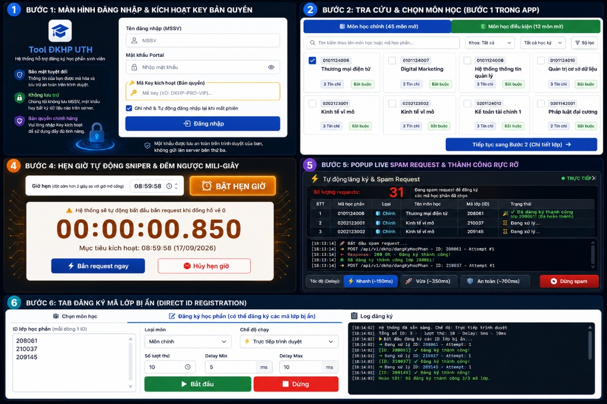

# ⚡ Tool Đăng Ký Học Phần Tự Động UTH (Web-DKHP Pro)

<div align="center">


<p align="center">
  <strong>Giải pháp tự động hóa đăng ký học phần thông minh, siêu tốc, chống nghẽn mạng dành cho sinh viên Đại học Giao thông Vận tải TP.HCM (UTH).</strong>
</p>

</div>

---

## 📸 SƠ ĐỒ HƯỚNG DẪN CHI TIẾT TỪ A - Z



---

## 🌟 ĐẶC ĐIỂM NỔI BẬT (KEY HIGHLIGHTS)

- ⚡ **Sniper Mở Cổng Siêu Tốc (High-Speed Sniper Loop):** Hẹn giờ chính xác tới từng mili-giây, tự động kích hoạt spam request ngay thời khắc cổng mở.
- 🔥 **Cơ chế Warmup Token 30s:** Tự động gửi gói tin làm nóng kết nối và làm mới phiên 30 giây trước giờ mở cổng, triệt tiêu độ trễ mạng ban đầu.
- 🛡️ **Tự Động Tự Phục Hồi (Self-Healing & Auto Re-login):** Tự động phát hiện phiên hết hạn (401 Unauthorized) và đăng nhập lại ngay lập tức mà không làm gián đoạn tiến trình.
- 🎯 **Tự Động Dispatching & Loại Bỏ Môn Đã ĐK:** Tự động điều hướng API phù hợp (môn chính quy vs. môn điều kiện) và gạt bỏ môn đã thành công ra khỏi vòng lặp để dồn toàn lực đăng ký các môn còn lại.
- 🕶️ **Đăng Ký Mã Lớp Bị Ẩn (Hidden Classes Enrollment):** Hỗ trợ tra cứu và đăng ký trực tiếp bằng ID lớp 6 số cho các lớp học phần bị ẩn trên giao diện Portal sinh viên.
- 📅 **Xem Trước Thời Khóa Biểu Tuần:** Trực quan hóa toàn bộ các lớp đã chọn lên ma trận thời khóa biểu tuần, tự động phát hiện và cảnh báo xung đột lịch học.
- 🔑 **Hệ Thống Bản Quyền & Định Danh Phần Cứng (HWID Bound):** Bảo vệ key theo Hardware ID của từng máy, hỗ trợ trang Quản trị Admin riêng biệt (`/admin.html`).
- 🌐 **Cụm Cổng Đa Luồng (Multi-Port Clustering):** Tự động mở rộng dải cổng từ `3000` đến `3009` khi cần chạy nhiều tiến trình cùng lúc.

---

## 🏗️ KIẾN TRÚC HỆ THỐNG & PIPELINE HOẠT ĐỘNG

```
                   ┌──────────────────────────────────────┐
                   │        GIAO DIỆN NGƯỜI DÙNG          │
                   │ (HTML5 / Vanilla CSS / ES6 UI)       │
                   └──────────────────┬───────────────────┘
                                      │
               ┌──────────────────────┴──────────────────────┐
               ▼                                             ▼
 ┌───────────────────────────┐                 ┌───────────────────────────┐
 │   BƯỚC 1: LỌC MÔN HỌC     │                 │   BƯỚC 2: CHỌN CHI TIẾT   │
 │ • Môn chính & Môn ĐK/GDTC │                 │ • Mã lớp HP to & ID 6 số  │
 │ • Tải tự động theo học kỳ │                 │ • Xem trước TKB trực quan │
 └─────────────┬─────────────┘                 └─────────────┬─────────────┘
               │                                             │
               └──────────────────────┬──────────────────────┘
                                      ▼
                   ┌──────────────────────────────────────┐
                   │    MODULE SNIPER & HẸN GIỜ (TIME)    │
                   │ • Đếm ngược mili-giây                │
                   │ • Warmup Session trước 30s           │
                   └──────────────────┬───────────────────┘
                                      │
                                      ▼
                   ┌──────────────────────────────────────┐
                   │   VÒNG LẶP SPAM REQUEST ĐA LUỒNG     │
                   │ • Delay tùy chỉnh: 150ms / 350ms     │
                   │ • Auto-Dispatch: Regular vs Cond API │
                   │ • Auto Retry & Re-login on 401       │
                   │ • Gạt bỏ môn thành công (Filter)     │
                   └──────────────────┬───────────────────┘
                                      │
                                      ▼
                   ┌──────────────────────────────────────┐
                   │      KẾT QUẢ & LIVE STREAM LOG       │
                   │ • Báo âm thanh chuông chúc mừng 🔔   │
                   │ • Cập nhật danh sách môn đã lưu      │
                   └──────────────────────────────────────┘
```

---

## 🚀 HƯỚNG DẪN CÀI ĐẶT & KHỞI CHẠY (SETUP & RUN)

### 1. Yêu cầu hệ thống
- **Node.js:** Phiên bản 16.x trở lên ([Tải tại đây](https://nodejs.org/)).
- Trình duyệt web hiện đại (Chrome, Edge, Brave, Firefox, Cốc Cốc...).

### 2. Cài đặt các thư viện
Mở Terminal hoặc PowerShell tại thư mục dự án và chạy lệnh:
```bash
npm install
```

### 3. Khởi chạy ứng dụng
Chế độ phát triển (Development / Hot-Reload):
```bash
npm run dev
```
Hoặc chế độ tiêu chuẩn:
```bash
npm start
```

### 4. Truy cập hệ thống
Mở trình duyệt và truy cập vào đường dẫn:
```
http://localhost:3000
```
*(Nếu cổng 3000 bị chiếm, server sẽ tự động chuyển sang 3001, 3002...)*

---

## 📖 HƯỚNG DẪN SỬ DỤNG TỪ A - Z (USER MANUAL)

### 🔑 Bước 1: Đăng nhập & Kích hoạt bản quyền
1. Nhập **Tên đăng nhập** (Mã số sinh viên - MSSV).
2. Nhập **Mật khẩu Portal** của trường.
3. Nhập **Mã Key kích hoạt** (do Admin cấp).
4. Tích chọn **"Ghi nhớ & Tự động đăng nhập lại khi mất phiên"** để duy trì kết nối xuyên suốt.
5. *(Tùy chọn)* Bấm vào biểu tượng 🌙/☀️ góc trên bên phải để chuyển sang chế độ **Dark Night**.

### 📚 Bước 2: Tích chọn môn học (Bước 1)
1. Tại tab **📚 Check môn học**, hệ thống sẽ tự động tải danh sách toàn bộ môn học trong kỳ.
2. Tích chọn các môn mong muốn tại danh mục **📘 Môn học chính**.
3. Chuyển sang danh mục **📗 Môn học điều kiện** để chọn thêm Giáo dục thể chất, Tiếng Anh hoặc các môn điều kiện khác.
4. Bấm **Tiếp tục sang Bước 2 (Chi tiết lớp) ➔**.

### 🔍 Bước 3: Chọn lớp học phần & Xem trước TKB
1. Xem thông tin lớp học phần:
   - **Mã lớp HP** (ví dụ: `010112400602`): Được hiển thị cỡ chữ lớn, in đậm nổi bật.
   - **ID lớp** (ví dụ: `208061`): Mã định danh 6 số dùng để bắn request đăng ký.
   - **Sĩ số:** Thanh trực quan hiển thị số lượng chỗ còn trống.
2. Tích chọn lớp ưu tiên hoặc các lớp dự phòng.
3. Bấm **"Xem trước TKB tuần"** tại thanh công cụ phía dưới để kiểm tra trực quan bảng lịch học, tránh bị trùng giờ.

### ⏰ Bước 4: Hẹn giờ Sniper hoặc Chạy ngay
- **Cách 1 - Hẹn giờ Sniper (Khuyên dùng trước giờ mở cổng):**
  1. Cài đặt giờ hẹn (ví dụ cổng mở lúc 09:00:00 thì đặt `08:59:58`).
  2. Bấm **⏰ BẬT HẸN GIỜ**.
  3. Hệ thống kích hoạt đồng hồ đếm ngược mili-giây, tự động warmup token trước 30 giây và tự động phóng request ngay khi đến giờ.
- **Cách 2 - Chạy ngay (Khi cổng trường đang mở):**
  1. Bấm **⚡ CHẠY NGAY**.
  2. Hệ thống mở cửa sổ Spam Request và liên tục bắn dữ liệu đăng ký.

### 📊 Bước 5: Theo dõi tiến trình & Hoàn tất
- Môn học khi đăng ký thành công sẽ chuyển sang **màu xanh lá**, có dấu `✓`, phát **chuông thông báo 🔔** và được tự động gạt ra khỏi vòng lặp spam.
- Toàn bộ chi tiết phản hồi từ máy chủ trường được hiển thị theo thời gian thực tại khung **Nhật ký trực tiếp (Live Stream Log)**.

---

## 👑 HỆ THỐNG QUẢN TRỊ ADMIN (KEY MANAGEMENT)

Hệ thống tích hợp trang quản lý bản quyền độc lập dành cho Quản trị viên:

- **Đường dẫn quản trị:** `http://localhost:3000/admin.html`
- **Mã PIN bảo mật mặc định:** `DKHP_SECRET_KEY_2026_PRO`

### Tính năng Admin:
- ➕ **Tạo Key mới:** Hỗ trợ tạo key tùy biến theo tên, thiết lập thời hạn sử dụng và số lượt kích hoạt.
- 🔒 **Khóa định danh phần cứng (HWID):** Key sau khi kích hoạt sẽ tự động gắn chặt vào phần cứng máy của sinh viên.
- 🔄 **Reset HWID:** Cho phép người dùng chuyển key sang máy tính khác khi cần.
- 📋 **Thống kê & Quản lý danh sách:** Bật/tắt trạng thái key hoặc thu hồi quyền truy cập tức thì.

---

## 📁 CẤU TRÚC THƯ MỤC DỰ ÁN

```
web-dkhp/
├── server.js                          # Express Server & Multi-Port Clustering
├── package.json                       # Cấu hình dự án & Dependencies
├── keys.json                          # Cơ sở dữ liệu License Key & HWID
├── README.md                          # Tài liệu tổng quan dự án
├── HUONG_DAN_SU_DUNG.md               # Tài liệu hướng dẫn sử dụng cho sinh viên
├── PIPELINE_HUONG_DAN_CHI_TIET_A_Z.md # Tài liệu kiến trúc & Pipeline chuyên sâu
├── routes/
│   ├── auth.js                        # API Đăng nhập, kiểm tra phiên, HWID & Admin
│   ├── courses.js                     # API Lấy danh sách môn học chính & điều kiện
│   ├── classes.js                     # API Lấy danh sách lớp học phần & chi tiết
│   └── registration.js                # API Đăng ký, hủy môn, check TKB
└── public/
    ├── index.html                     # Giao diện chính người dùng (UI + Modal Guide)
    ├── admin.html                     # Giao diện Quản trị viên quản lý Key
    ├── css/
    │   ├── style.css                  # Toàn bộ CSS giao diện ứng dụng
    │   └── admin.css                  # CSS trang quản trị
    ├── js/
    │   ├── api.js                     # Module kết nối HTTP API & Client Storage
    │   ├── app.js                     # Toàn bộ Logic giao diện, Wizard, Sniper
    │   └── admin.js                   # Logic trang quản trị
    └── images/
        ├── huong_dan_chi_tiet_a_z.jpg # Infographic hướng dẫn sử dụng 6 bước
        └── pipeline_guide.jpg         # Banner sơ đồ pipeline kiến trúc
```

---

## 🤖 PROMPTS TẠO ẢNH & SƠ ĐỒ HỆ THỐNG (AI PROMPTS)

Nếu bạn muốn tạo lại hoặc mở rộng các hình ảnh banner, infographic sơ đồ hệ thống bằng các công cụ AI (như Midjourney, DALL-E 3, Flux Pro, Nanobanana):

### Prompt 1: Infographic Sơ Đồ Quy Trình 6 Bước (Horizontal / Vertical Layout)
```text
A professional, ultra-clean UI/UX infographic poster explaining a 6-step automated course registration pipeline for university students. Modern glassmorphism technology theme with deep navy and cyan glowing accents. The 6 numbered sequential steps are clearly rendered: 1. Secure Login & Activation Key, 2. Course Catalog Filter (Main & Conditional Subjects), 3. Select Class Schedule & Live Weekly Preview, 4. Millisecond Sniper Countdown Timer with 30s Auto Warmup, 5. High-Speed Request Loop & Auto Re-login, 6. Registration Success with Green Checkmark and Bell Notification. Include sleek vector icons, high-tech dashboard elements, crisp typography, 8k resolution, vector art style, clean infographics design.
```

### Prompt 2: Banner Công Nghệ Sniper Tốc Độ Cao
```text
Futuristic dashboard concept art of an automated high-speed sniper bot interface for college course enrollment. Featuring modern technology theme with neon cyan, emerald green, and sapphire blue highlights, glassmorphism cards, glowing countdown timer display, floating weekly schedule matrix, and animated lightning speed connection waves. Ultra-modern, premium software interface aesthetic, high-end SaaS product style, 8k resolution, hyper-detailed.
```

---

## ⚠️ LƯU Ý BẢO MẬT & TUYÊN BỐ MIỄN TRỪ (DISCLAIMER)

- 🔒 **Bảo mật tuyệt đối thông tin sinh viên:** Công cụ chạy hoàn toàn trên máy cục bộ (Localhost). Mật khẩu và thông tin tài khoản được lưu trữ an toàn trong LocalStorage của trình duyệt, **không bao giờ** bị gửi tới bất kỳ máy chủ bên thứ ba nào.
- ⚡ **Khuyến nghị tốc độ gửi:** Khi trường vừa mở cổng, nên đặt tốc độ **Nhanh (~150ms)**. Sau khi đã săn được các môn chính, nên chuyển sang **Vừa (~350ms)** hoặc **An toàn (~700ms)** để đảm bảo ổn định đường truyền mạng.

---

<div align="center">
  <strong>Được phát triển với niềm đam mê công nghệ & hỗ trợ sinh viên UTH đạt kết quả học tập tốt nhất! 🚀</strong>
</div>
